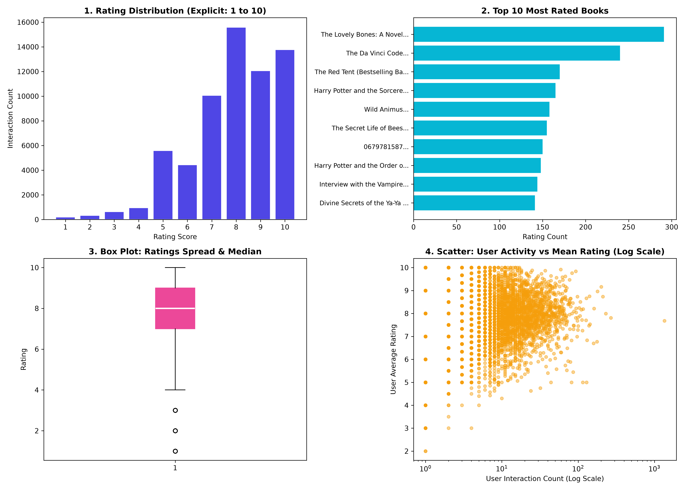

<div dir="rtl">

# 🎬 سامانه هوشمند و چندحوزه‌ای پیشنهاددهنده فیلم و کتاب (Cross-Domain Recommender System)

**تهیه‌کننده: ابراهیم یدالهی**  
**درس:** آزمایشگاه هوش مصنوعی  
**مخزن اصلی گیت‌هاب:** [movie-book-recommender](https://github.com/ebrahimy5280-del/movie-book-recommender)[cite: 1]

---

> 💡 **چکیده اجرایی و معماری کلان پروژه:**  
> سامانه حاضر یک سیستم پیشنهاددهنده هوشمند چندحوزه‌ای (Cross-Domain Recommender System) است که با هدف مدل‌سازی، پیش‌بینی و پالایش علایق کاربران در دو رسانه مکمل فیلم و کتاب بر مبنای اصول مهندسی نرم‌افزار، چارچوب‌های عامل هوشمند و یادگیری ماشین طراحی و توسعه داده شده است[cite: 1]. ساختار این مخزن به‌گونه‌ای طراحی شده که تفکیک کاملی میان تکالیف هفتگی آزمایشگاه و فازهای سه‌گانه توسعه سامانه برقرار سازد و تمامی مراحل از مدل‌سازی مسئله در قالب فرمولاسیون ریاضی تا ممیزی کیفیت داده و مصورسازی آماری را با بالاترین استانداردهای آکادمیک و فنی ارائه دهد[cite: 1].

---

## 🗂️ معماری و ساختار جامع فایل‌ها و دایرکتوری‌ها

ساختار مخزن بر مبنای تفکیک ماژولار و جلوگیری از درهم‌تنیدگی کدهای پژوهشی با تکالیف آزمایشگاهی سازمان‌دهی شده است:

</div>

```text
movie-book-recommender/
│
├── weekly_assignments/                     # تکالیف و نوت‌بوک‌های هفتگی آزمایشگاه
│   ├── check_env.ipynb                     # بررسی پایداری وابستگی‌های محیط، نسخه‌ها و سخت‌افزار
│   ├── lab2_pathfinding.ipynb              # شبیه‌سازی و مقایسه جامع الگوریتم‌های جستجوی ناآگاهانه و آگاهانه
│   └── README.md                           # جدول زمان‌بندی و گزارش تمرین‌های کلاسی
│
├── movie_book_recommender_project/         # بسته اصلی توسعه سیستم هوشمند پیشنهاددهنده
│   ├── Step-1/                             # گام اول: تعریف مسئله، مدل‌سازی محیط و شبیه‌سازی عامل‌ها
│   │   ├── notes/
│   │   │   └── risks.md                    # مستندات تحلیلی ریسک‌ها، سوگیری‌ها و معیارهای ارزیابی آفلاین
│   │   ├── recommender_agent.py            # پیاده‌سازی شیءگرای شبیه‌سازی عامل‌های تصادفی، واکنشی و مدل‌محور
│   │   └── README.md                       # مستندات و گزارش جامع تحلیلی فاز اول
│   │
│   ├── Step-2/                             # گام دوم: مهندسی داده، ممیزی، معماری سیستم و تفکیک پایپ‌لاین
│   │   ├── data/
│   │   │   ├── train.csv                   # پایگاه داده آموزش با نسبت ۸۰٪
│   │   │   ├── test.csv                    # پایگاه داده آزمون با نسبت ۲۰٪ (تفکیک قطعی)
│   │   │   └── rating_evaluation.png       # مصورسازی ارزیابی توزیع بازخوردها و پوشش داده‌ها
│   │   ├── src/
│   │   │   ├── data_loader.py              # خط لوله بارگذاری خودکار، پاک‌سازی و تفکیک بدون نشت داده
│   │   │   ├── evaluation.py               # موتور محاسباتی ممیزی نشت داده، نرخ تخلخل و شاخص‌های آماری
│   │   │   └── evaluation.ipynb            # نوت‌بوک تعاملی تحلیل ماتریس تعاملات و نمایش ساختار رابطه‌ای
│   │   ├── DESIGN.md                       # سند جامع معماری، روابط ریاضی، طرح‌واره داده‌ها و استراتژی ارزیابی
│   │   ├── documentation.md                # گزارش مستندسازی فنی و ممیزی‌های انجام‌شده
│   │   └── README.md                       # مستندات تفصیلی و تشریح پایپ‌لاین گام دوم
│   │
│   ├── Step-3/                             # گام سوم: تحلیل اکتشافی جامع داده‌ها (EDA) و مصورسازی آماری
│   │   ├── data/
│   │   │   ├── items.csv                   # جدول ویژگی‌ها و متادیتای اقلام (فیلم‌ها و کتاب‌ها)
│   │   │   ├── ratings.csv                 # ماتریس خام تعاملات، شناسه کاربران، امتیازها و برچسب‌های زمانی
│   │   │   └── eda_analysis.png            # خروجی گرافیکی گرید ۴ نمودار تحلیلی با کیفیت بالا (DPI 300)
│   │   ├── src/
│   │   │   └── eda.ipynb                   # نوت‌بوک محاسباتی و تحلیلی EDA با پیاده‌سازی ممیزی برداری
│   │   └── README.md                       # مستندات فنی و گزارش جامع پیاده‌سازی گام سوم
│   │
│   ├── environment.yml                     # تعریف مشخصات و وابستگی‌های محیط ایزوله Conda
│   └── requirements.txt                    # فهرست دقیق پکیج‌های پایتون جهت نصب با pip
│
└── README.md                               # راهنما، شناسنامه و داشبورد مدیریتی کلان کل مخزن
```

<div dir="rtl">

---

## 📊 داشبورد وضعیت و ماتریس پیشرفت فازهای سه‌گانه پروژه

<table dir="rtl" style="width: 100%; text-align: right;">
  <thead>
    <tr>
      <th style="text-align: right;">فاز و گام پروژه</th>
      <th style="text-align: right;">اهداف کلیدی و استانداردهای مهندسی</th>
      <th style="text-align: right;">ماژول‌ها و پیوندهای مخزن</th>
      <th style="text-align: right;">وضعیت</th>
    </tr>
  </thead>
  <tbody>
    <tr>
      <td style="text-align: right;"><b>گام اول (Step-1)</b></td>
      <td style="text-align: right;">فرمولاسیون مسئله در چارچوب PEAS، بررسی مشخصه‌های محیطی، پیاده‌سازی عامل‌های تصادفی، واکنشی و مبتنی بر مدل</td>
      <td style="text-align: right;" dir="ltr"><a href="https://github.com/ebrahimy5280-del/movie-book-recommender/blob/main/movie_book_recommender_project/Step-1/recommender_agent.py"><code>recommender_agent.py</code></a>, <a href="https://github.com/ebrahimy5280-del/movie-book-recommender/blob/main/movie_book_recommender_project/Step-1/notes/risks.md"><code>risks.md</code></a></td>
      <td style="text-align: right;">✔️ تکمیل و مستندسازی شد[cite: 1]</td>
    </tr>
    <tr>
      <td style="text-align: right;"><b>گام دوم (Step-2)</b></td>
      <td style="text-align: right;">جمع‌آوری داده‌ها، جداسازی قطعی ۸۰/۲۰، سنجش نرخ تخلخل (Sparsity)، اثبات ریاضی عدم نشت داده (Data Leakage) و تدوین سند طراحی معماری</td>
      <td style="text-align: right;" dir="ltr"><a href="https://github.com/ebrahimy5280-del/movie-book-recommender/blob/main/movie_book_recommender_project/Step-2/src/data_loader.py"><code>data_loader.py</code></a>, <a href="https://github.com/ebrahimy5280-del/movie-book-recommender/blob/main/movie_book_recommender_project/Step-2/src/evaluation.py"><code>evaluation.py</code></a>, <a href="https://github.com/ebrahimy5280-del/movie-book-recommender/blob/main/movie_book_recommender_project/Step-2/DESIGN.md"><code>DESIGN.md</code></a></td>
      <td style="text-align: right;">✔️ تکمیل و مستندسازی شد[cite: 1]</td>
    </tr>
    <tr>
      <td style="text-align: right;"><b>گام سوم (Step-3)</b></td>
      <td style="text-align: right;">ممیزی کیفیت داده‌ها، استخراج آماره‌های توصیفی برداری، مقایسه رفتار رسانه‌ها و تولید بوم گرافیکی ۴ نمودار تحلیلی با کیفیت ۳۰۰ DPI</td>
      <td style="text-align: right;" dir="ltr"><a href="https://github.com/ebrahimy5280-del/movie-book-recommender/blob/main/movie_book_recommender_project/Step-3/src/eda.ipynb"><code>eda.ipynb</code></a>, <a href="https://github.com/ebrahimy5280-del/movie-book-recommender/blob/main/movie_book_recommender_project/Step-3/data/eda_analysis.png"><code>eda_analysis.png</code></a>, <a href="https://github.com/ebrahimy5280-del/movie-book-recommender/blob/main/movie_book_recommender_project/Step-3/README.md"><code>README.md</code></a></td>
      <td style="text-align: right;">✔️ تکمیل و مستندسازی شد[cite: 1, 11]</td>
    </tr>
  </tbody>
</table>

---

## 🧩 فاز اول: فرمولاسیون مسئله، تحلیل محیط و شبیه‌سازی عامل‌های هوشمند (Step-1)

در گام نخست، سیستم پیشنهاددهنده به عنوان یک عامل هوشمند در تعامل با کاربر و محیط محتوا فرمول‌بندی شد[cite: 1]:

### ۱. تحلیل چارچوب PEAS
* **معیار عملکرد (Performance Measure):** بیشینه‌سازی تناسب پیشنهادها با سلایق واقعی، افزایش نرخ تبدیل و نرخ رضایت (امتیازهای ۴ و ۵) و کمینه‌سازی خطای پیش‌بینی.
* **محیط (Environment):** اقلام چندحوزه‌ای (فیلم‌ها و کتاب‌ها)، ماتریس تنک تعاملات، ژانرها و ویژگی‌های محتوایی.
* **عملگرها (Actuators):** انتخاب و رتبه‌بندی فهرست پیشنهادی K تایی (Top-K Recommendations) و نمایش به کاربر.
* **حسگرها (Sensors):** لاگ بازخوردهای صریح (امتیازهای عددی ۱ تا ۵) و تاریخچه تعاملات قبلی.

### ۲. ویژگی‌های محیط عامل
محیط پیشنهاددهی بر اساس تعاریف هوش مصنوعی دارای ویژگی‌های زیر است:
* **مشاهده‌پذیری جزئی (Partially Observable):** علایق و انگیزه‌های روانی کاربر به صورت کامل و شفاف در دسترس نیست.
* **غیرقطعی و تصادفی (Stochastic):** واکنش کاربر به یک اثر می‌تواند تحت تأثیر متغیرهای پنهان (خلق‌وخو، زمان تماشا و...) تغییر کند.
* **ترتیبی (Sequential):** هر انتخاب و بازخورد کاربر، وضعیت فضای علایق او را برای پیشنهادهای بعدی دستخوش تغییر می‌کند.
* **پویا (Dynamic):** محتوای کاتالوگ و سلیقه کاربران با گذر زمان تغییر می‌یابد.
* **تک‌عاملی (Single-Agent):** سامانه پیشنهاددهنده به عنوان هسته متمرکز تصمیم‌گیری عمل می‌کند.

### ۳. عامل‌های توسعه‌داده‌شده در [`recommender_agent.py`](https://github.com/ebrahimy5280-del/movie-book-recommender/blob/main/movie_book_recommender_project/Step-1/recommender_agent.py)
* 🔹 **عامل تصادفی (Random Agent):** بدون توجه به سوابق و صرفاً بر اساس توزیع یکنواخت تصمیم می‌گیرد؛ این عامل مبنای پایه (Baseline) برای سنجش ارزش افزوده مدل‌های دیگر است.
* 🔹 **عامل واکنشی (Reflex Agent):** تصمیم‌گیری مستقیم بر اساس نگاشت وضعیت به عمل (شرط-عمل)؛ مانند ترجیح ژانر آخرین اثر دیده‌شده.
* 🔹 **عامل مبتنی بر مدل (Model-Based Agent):** نگهداری یک حالت درونی (Internal State) از وزن‌های علایق کاربر به تفکیک ژانرها و به‌روزرسانی تدریجی ماتریس سلایق با دریافت هر فیدبک جدید.

---

## 📊 فاز دوم: خط لوله داده‌ها، ممیزی، معماری سامانه و ارزیابی آفلاین (Step-2)

گام دوم زیرساخت فنی داده‌محور پروژه را پیاده‌سازی کرد[cite: 1]:

### ۱. ماژول خط لوله داده‌ها ([`data_loader.py`](https://github.com/ebrahimy5280-del/movie-book-recommender/blob/main/movie_book_recommender_project/Step-2/src/data_loader.py))
این اسکریپت وظیفه دریافت، پاک‌سازی، یکسان‌سازی تایپ‌ها و تقسیم قطعی داده‌ها به نسبت ۸۰٪ آموزش ([`train.csv`](https://github.com/ebrahimy5280-del/movie-book-recommender/blob/main/movie_book_recommender_project/Step-2/data/train.csv)) و ۲۰٪ آزمون ([`test.csv`](https://github.com/ebrahimy5280-del/movie-book-recommender/blob/main/movie_book_recommender_project/Step-2/data/test.csv)) را بدون هم‌پوشانی بر عهده دارد.

### ۲. موتور ممیزی و ارزیابی ([`evaluation.py`](https://github.com/ebrahimy5280-del/movie-book-recommender/blob/main/movie_book_recommender_project/Step-2/src/evaluation.py))
* **ممیزی نشت داده (Data Leakage Verification):** تضمین صفر بودن اشتراک زوج‌های `(user_id, item_id)` میان مجموعه‌های Train و Test.
* **محاسبه نرخ تخلخل ماتریس (Sparsity Rate):** سنجش میزان تنکی داده‌ها بر اساس فرمول:
  $$\text{Sparsity} = 1 - \frac{\vert{}R\vert{}}{\vert{}U\vert{} \times \vert{}I\vert{}}$$
* **تحلیل ماتریس تعاملات:** مصورسازی وضعیت حضور نمرات در فضای دوبعدی کاربر-آیتم در نوت‌بوک [`evaluation.ipynb`](https://github.com/ebrahimy5280-del/movie-book-recommender/blob/main/movie_book_recommender_project/Step-2/src/evaluation.ipynb).

### ۳. سند جامع طراحی معماری سامانه ([`DESIGN.md`](https://github.com/ebrahimy5280-del/movie-book-recommender/blob/main/movie_book_recommender_project/Step-2/DESIGN.md))
تدوین روابط ریاضی معیارهای رتبه‌بندی نظیر Precision@K، Recall@K، NDCG@K، فرمولاسیون فیلترینگ مشارکتی بر پایه شباهت کسینوسی و همبستگی پیرسون و راهکارهای مدیریت چالش شروع سرد (Cold Start).

---

## 📈 فاز سوم: تحلیل اکتشافی جامع داده‌ها (EDA) و مصورسازی آماری (Step-3)

در گام سوم، کلیه آزمون‌های سلامت داده و آماره‌های توصیفی به همراه گرید گرافیکی چهارگانه در نوت‌بوک [`eda.ipynb`](https://github.com/ebrahimy5280-del/movie-book-recommender/blob/main/movie_book_recommender_project/Step-3/src/eda.ipynb) پیاده‌سازی و اجرا گردید[cite: 1, 11]:

<div align="center">

[cite: 11]

</div>

<table dir="rtl" style="width: 100%; text-align: right;">
  <thead>
    <tr>
      <th style="text-align: right;">ردیف</th>
      <th style="text-align: right;">نمودار تحلیلی</th>
      <th style="text-align: right;">نوع بصری‌سازی</th>
      <th style="text-align: right;">خروجی شاخص عددی</th>
      <th style="text-align: right;">تفسیر فنی و نتیجه مهندسی در سیستم پیشنهاددهنده</th>
    </tr>
  </thead>
  <tbody>
    <tr>
      <td style="text-align: right;"><b>۱</b></td>
      <td style="text-align: right;"><b>توزیع نمرات (Rating Distribution)</b></td>
      <td style="text-align: right;">Bar Plot / Histogram</td>
      <td style="text-align: right;">۷۰.۸٪ نمرات در بازه ۴ و ۵[cite: 11]</td>
      <td style="text-align: right;">وجود چولگی به راست و سوگیری مثبت (Positivity Bias)؛ نشان‌دهنده لزوم اجرای نرمال‌سازی انحراف از میانگین (Mean-Centering) در گام مدل‌سازی مشارکتی.</td>
    </tr>
    <tr>
      <td style="text-align: right;"><b>۲</b></td>
      <td style="text-align: right;"><b>حجم تعاملات رسانه‌ها (Volume by Type)</b></td>
      <td style="text-align: right;">Categorical Bar Plot</td>
      <td style="text-align: right;">۱۳ امتیاز فیلم در برابر ۱۱ امتیاز کتاب[cite: 11]</td>
      <td style="text-align: right;">توازن بسیار مطلوب بین دو رسانه؛ تضمین اینکه مدل آموزش‌دیده نهایی دچار غلبه نامتقارن یک رسانه بر دیگری (Media Bias) نخواهد شد[cite: 11].</td>
    </tr>
    <tr>
      <td style="text-align: right;"><b>۳</b></td>
      <td style="text-align: right;"><b>نمودار جعبه‌ای نمرات (Boxplot Distribution)</b></td>
      <td style="text-align: right;">Box & Whisker Plot</td>
      <td style="text-align: right;">میانه یکسان ۴.۰ و بدون داده پرت (Outliers)[cite: 11]</td>
      <td style="text-align: right;">همگنی ساختار توزیع بازخوردها در هر دو حوزه؛ اثبات امکان ادغام فضای ویژگی‌ها در قالب مدل توصیه‌گر ترکیبی میان‌حوزه‌ای (Cross-Domain)[cite: 11].</td>
    </tr>
    <tr>
      <td style="text-align: right;"><b>۴</b></td>
      <td style="text-align: right;"><b>پراکندگی فعالیت کاربران (User Engagement)</b></td>
      <td style="text-align: right;">Discrete Histogram</td>
      <td style="text-align: right;">دقیقاً ۴ تعامل ثبت‌شده به ازای هر کاربر[cite: 11]</td>
      <td style="text-align: right;">توازن کامل بازخورد کاربران اولیه؛ شرایط ایده‌آل و بدون سوگیری برای ارزیابی عادلانه عملکرد فیلترینگ مشارکتی بر پایه کاربر (User-Based CF)[cite: 11].</td>
    </tr>
  </tbody>
</table>

---

## 🔬 جدول مقایسه تطبیقی آماری فیلم و کتاب (Cross-Domain Comparison)

تحلیل داده‌های تلفیق‌شده با متد `groupby("item_type")` در اسکریپت تحلیلی گام سوم[cite: 11]:

<table dir="rtl" style="width: 100%; text-align: right;">
  <thead>
    <tr>
      <th style="text-align: right;">شاخص مقایسه‌ای</th>
      <th style="text-align: right;">رسانه فیلم (Movies)</th>
      <th style="text-align: right;">رسانه کتاب (Books)</th>
      <th style="text-align: right;">تحلیل تطبیقی و استنتاج مهندسی</th>
    </tr>
  </thead>
  <tbody>
    <tr>
      <td style="text-align: right;"><b>تعداد تعاملات (Interaction Count)</b></td>
      <td style="text-align: right;">۱۳ تعامل (۵۴.۲٪)</td>
      <td style="text-align: right;">۱۱ تعامل (۴۵.۸٪)</td>
      <td style="text-align: right;">توزیع کاملاً متعادل و بدون افتادن در دام کلاس نامتوازن[cite: 11]</td>
    </tr>
    <tr>
      <td style="text-align: right;"><b>میانگین امتیازات (Mean Rating)</b></td>
      <td style="text-align: right;">۳.۹۲</td>
      <td style="text-align: right;">۴.۰۰</td>
      <td style="text-align: right;">نمرات کتاب‌ها به دلیل گزینش آگاهانه‌تر کاربران اندکی بالاتر است[cite: 11]</td>
    </tr>
    <tr>
      <td style="text-align: right;"><b>انحراف معیار (Standard Deviation)</b></td>
      <td style="text-align: right;">۱.۱۲</td>
      <td style="text-align: right;">۱.۰۰</td>
      <td style="text-align: right;">تنوع دیدگاه و پراکندگی سلایق در بین تماشاگران فیلم بالاتر است[cite: 11]</td>
    </tr>
    <tr>
      <td style="text-align: right;"><b>واریانس نمرات (Variance)</b></td>
      <td style="text-align: right;">۱.۲۵</td>
      <td style="text-align: right;">۱.۰۰</td>
      <td style="text-align: right;">هم‌پوشانی و ثبات بالاتر نظرات در جامعه کتاب‌خوان‌ها نسبت به فیلم‌ها[cite: 11]</td>
    </tr>
    <tr>
      <td style="text-align: right;"><b>میانه نمرات (Median / 50%)</b></td>
      <td style="text-align: right;">۴.۰۰</td>
      <td style="text-align: right;">۴.۰۰</td>
      <td style="text-align: right;">انطباق کامل نقطه ثقل رضایت عمومی در هر دو حوزه محتوایی[cite: 11]</td>
    </tr>
    <tr>
      <td style="text-align: right;"><b>دامنه بین‌چارکی (IQR Range)</b></td>
      <td style="text-align: right;">۳.۰۰ تا ۵.۰۰</td>
      <td style="text-align: right;">۳.۵۰ تا ۵.۰۰</td>
      <td style="text-align: right;">فشردگی ۵۰ درصد میانی امتیازهای کتاب در بازه نمرات ممتاز[cite: 11]</td>
    </tr>
    <tr>
      <td style="text-align: right;"><b>داده‌های پرت و خارج از محدوده (Outliers)</b></td>
      <td style="text-align: right;">۰ مورد</td>
      <td style="text-align: right;">۰ مورد</td>
      <td style="text-align: right;">پایداری آماری بالا و قابلیت اتکا برای پیش‌بینی‌های مدل یادگیری[cite: 11]</td>
    </tr>
  </tbody>
</table>

---

## 🛠️ مشخصات فنی و محیط توسعه پایدار سیستم

تمامی پایپ‌لاین‌ها بر روی سیستم‌عامل ویندوز ۱۱ ویرایش ۶۴ بیتی اعتبارسنجی شده و پایداری کدهای آن به ثبت رسیده است[cite: 11]:

<table dir="rtl" style="width: 100%; text-align: right;">
  <thead>
    <tr>
      <th style="text-align: right;">ابزار / کتابخانه</th>
      <th style="text-align: right;">نسخه پایدار</th>
      <th style="text-align: right;">نقش در پایپ‌لاین و معماری نرم‌افزار</th>
    </tr>
  </thead>
  <tbody>
    <tr>
      <td style="text-align: right;"><b>Python</b></td>
      <td style="text-align: right;" dir="ltr">3.14.0</td>
      <td style="text-align: right;">محیط اصلی مفسر و توسعه کدها</td>
    </tr>
    <tr>
      <td style="text-align: right;"><b>Pandas</b></td>
      <td style="text-align: right;" dir="ltr">3.0.5</td>
      <td style="text-align: right;">موتور مدیریت دیتافریم‌ها، ادغام رابطه‌ای، ممیزی کیفیت و محاسبات تجمیعی</td>
    </tr>
    <tr>
      <td style="text-align: right;"><b>NumPy</b></td>
      <td style="text-align: right;" dir="ltr">2.5.2</td>
      <td style="text-align: right;">محاسبات برداری سریع ریاضی، محاسبه آماره‌های توصیفی و جبر خطی</td>
    </tr>
    <tr>
      <td style="text-align: right;"><b>Matplotlib</b></td>
      <td style="text-align: right;" dir="ltr">3.11.1</td>
      <td style="text-align: right;">موتور رسم گرید ۴ نمودار تحلیلی با تنظیم مستقیم تیک‌های محوری و سازگاری کامل[cite: 11]</td>
    </tr>
    <tr>
      <td style="text-align: right;"><b>Jupyter Notebook / Lab</b></td>
      <td style="text-align: right;" dir="ltr">1.1.1</td>
      <td style="text-align: right;">محیط تعاملی توسعه و مصورسازی نتایج ممیزی و EDA</td>
    </tr>
  </tbody>
</table>

---

## 🚀 راهنمای نصب و راه‌اندازی سریع پروژه (Quick Start Guide)

جهت کلون‌سازی مخزن و اجرای کامل محیط ایزوله:

### ۱. دریافت مخزن از گیت‌هاب
```bash
git clone [https://github.com/ebrahimy5280-del/movie-book-recommender.git](https://github.com/ebrahimy5280-del/movie-book-recommender.git)
cd movie-book-recommender
```

### ۲. راه‌اندازی محیط مجازی با Conda یا Pip
استفاده از Conda (روش پیشنهادی):
```bash
conda env create -f movie_book_recommender_project/environment.yml
conda activate ailab
```
*یا نصب مستقیم با پکیج منیجر Pip:*
```bash
python -m pip install -r movie_book_recommender_project/requirements.txt
```

### ۳. اجرای ماژول‌ها و پایپ‌لاین‌های مراحل مختلف
```bash
# اجرای شبیه‌سازی عامل‌های هوشمند گام اول
python movie_book_recommender_project/Step-1/recommender_agent.py

# اجرای تفکیک داده و ممیزی عدم نشت گام دوم
python movie_book_recommender_project/Step-2/src/data_loader.py
python movie_book_recommender_project/Step-2/src/evaluation.py

# اجرای محیط نوت‌بوک تحلیلی EDA گام سوم
cd movie_book_recommender_project/Step-3/src
jupyter notebook eda.ipynb
```

---

## 🗺️ نقشه راه توسعه و فازهای آتی (Project Roadmap)

- [x] **گام اول:** پیاده‌سازی و شبیه‌سازی عامل‌های سه‌گانه هوشمند (تصادفی، واکنشی، مدل‌محور) در چارچوب PEAS[cite: 1]
- [x] **گام دوم:** معماری خط لوله تفکیک داده Train/Test، ممیزی عدم نشت و محاسبه نرخ تخلخل[cite: 1]
- [x] **گام دوم:** تدوین سند جامع طراحی سیستم، فرمولاسیون ریاضی و معیارهای ارزیابی در `DESIGN.md`[cite: 1]
- [x] **گام سوم:** پیاده‌سازی خط لوله تحلیل اکتشافی داده‌ها (EDA) و ممیزی سلامت داده‌ها در نوت‌بوک[cite: 1, 11]
- [x] **گام سوم:** طراحی بوم گرافیکی ۴ نمودار تحلیلی با کیفیت ۳۰۰ DPI و حل تعارضات کتابخانه ترسیم[cite: 6, 11]
- [x] **تکلیف هفتگی:** پیاده‌سازی مقایسه جامع الگوریتم‌های جستجو در `lab2_pathfinding.ipynb`
- [ ] **گام چهارم:** پیاده‌سازی مدل‌های مشارکتی بر پایه کاربر و آیتم (User-Based & Item-Based Collaborative Filtering)
- [ ] **گام چهارم:** به‌کارگیری الگوریتم‌های فاکتورگیری ماتریسی نظیر SVD جهت رفع چالش داده‌های تنک
- [ ] **گام پنجم:** پیاده‌سازی سیستم رتبه‌بندی مجدد تنوع‌محور بر پایه Maximal Marginal Relevance (MMR)
- [ ] **گام پنجم:** تست جامع آفلاین با معیارهای NDCG@K، Precision@K، Recall@K و پوشش کاتالوگ

---


 
</div>
