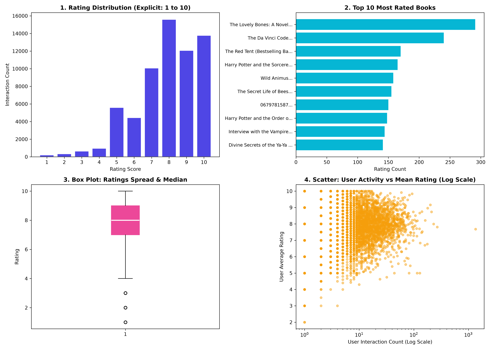

<div dir="rtl">

# گام سوم: تحلیل اکتشافی داده‌ها (EDA) و توسعه پایپ‌لاین تحلیلی
**توسعه‌دهنده و مهندس نرم‌افزار (Software & Pipeline Implementation)**

این مستند، گزارش جامع و تخصصی پیاده‌سازی خط لوله تحلیل اکتشافی داده‌ها (Exploratory Data Analysis) در سیستم هوشمند پیشنهاددهنده کتاب و فیلم است[cite: 1]. در این فاز، تمرکز اصلی بر طراحی و اجرای پایپ‌لاین‌های اعتبارسنجی داده، محاسبه شاخص‌های توصیفی، ترسیم نمودارهای تحلیلی ماتریس تعاملات و مصورسازی رفتار کاربران با استفاده از پایتون، کتابخانه‌های Pandas، NumPy و Matplotlib بوده است[cite: 1, 2].

---

## ۱. ساختار ماژولار و سازمان‌دهی فایل‌ها

تمامی کدهای پردازشی، داده‌های ورودی و برون‌دادهای بصری مطابق استاندارد پروژه‌های داده‌محور تفکیک و جانمایی شده‌اند:

</div>

```text
Step-3/
├── data/
│   ├── items.csv            # متادیتا و خصوصیات اقلام (فیلم‌ها و کتاب‌ها)
│   ├── ratings.csv          # لاگ بازخوردها، برچسب‌های زمانی و امتیازات کاربران
│   └── eda_analysis.png     # برون‌داد گرافیکی نمودارهای چهارگانه تحلیلی (DPI 300)
├── src/
│   └── eda.ipynb            # نوت‌بوک تعاملی شامل کدهای ممیزی، محاسباتی و بصری‌سازی
└── README.md                # مستندات فنی و گزارش جامع پیاده‌سازی گام سوم
```

<div dir="rtl">

---

## ۲. شرح مسئولیت‌ها و دستاوردهای نقش کدنویسی (Code Implementation)

به عنوان مسئول پیاده‌سازی نرم‌افزاری و کدنویسی این گام، وظایف فنی زیر به‌صورت کامل انجام و مستقر شد[cite: 1]:

* **مدیریت ساختار فایل‌ها و مسیردهی هوشمند (Dynamic Path Management):** پیاده‌سازی ساختار فایل‌ها با استفاده از شیء‌گرایی پایتون و کلاس `pathlib.Path` به‌جای استفاده از مسیرهای ایستا (Hardcoded strings)، تا کد بدون وابستگی به سیستم‌عامل (Cross-Platform) روی هر دو محیط Windows و Linux بدون خطا اجرا شود[cite: 11].
* **طراحی خط لوله ادغام داده‌ها (Relational Data Merging):** تجمیع جداول مجزای اقلام و امتیازات با استفاده از `pd.merge` بر اساس کلید خارجی `item_id` جهت تحلیل‌های ترکیبی و متقاطع بین حوزه رسانه و نمرات کاربران.
* **طراحی موتور ممیزی کیفیت داده (Automated Data Quality Audit):** کدنویسی اعتبارسنجی خودکار برای سنجش سلامت دیتاست، شناسایی مقادیر مفقود (Missing Values)، ردیابی رکوردهای تکراری و اعتبارسنجی نوع داده‌ها (Data Types) طبق چک‌لیست آزمایشگاه[cite: 1, 11].
* **پیاده‌سازی ماژول آمار توصیفی (Descriptive Statistics Engine):** استخراج کمیت‌های آماری پایه (میانگین، انحراف معیار، واریانس، میانه و دامنه‌های چارکی) با متدهای بهینه‌شده Pandas و NumPy بدون نیاز به محاسبات دستی یا حلقه‌های کند پایتونی[cite: 1, 11].
* **حل چالش سازگاری نسخه‌های Matplotlib:** رفع خطای ناشی از تغییرات ساختاری نسخه‌های جدید Matplotlib (نسخه ۳.۹ به بعد) در رسم نمودارهای جعبه‌ای با تنظیم مستقیم تیک‌ها و برچسب‌های محور (`set_xticks` و `set_xticklabels`)[cite: 6].
* **طراحی و چیدمان گرید بصری چهارگانه (2x2 Multi-plot Canvas):** پیاده‌سازی چهار نمودار مکمل تحلیلی در یک قاب یکپارچه همراه با استایل بصری خوانا و تنظیم دقیق فاصله‌ها با `plt.tight_layout`.
* **موتور اتوماسیون خروجی (Export Engine):** کدنویسی ذخیره‌سازی خودکار نمودارها با کیفیت نشر بالا (`dpi=300`) و حاشیه‌بندی دقیق (`bbox_inches='tight'`) در پوشه هدف به صورت همگام با اجرای اسکریپت[cite: 11].

---

## ۳. تحلیل خط به خط و معماری کد نوت‌بوک (`src/eda.ipynb`)

کدهای توسعه‌داده‌شده درون نوت‌بوک بر مبنای ماژولاریتی و خوانایی بالا در ۵ بخش تفکیک شده‌اند:

### بخش اول: بارگذاری داده‌ها و تلفیق رابطه‌ای
ابتدا آدرس‌های نسبی نسبت به پوشه اجرایی اسکریپت به کمک کتابخانه `pathlib` ساخته می‌شوند:
```python
data_dir = Path("../data")
ratings_path = data_dir / "ratings.csv"
items_path = data_dir / "items.csv"

df_ratings = pd.read_csv(ratings_path)
df_items = pd.read_csv(items_path)
df_merged = pd.merge(df_ratings, df_items, on="item_id")
```
عملیات ادغام (Inner Join) انجام شده در این بخش ستون‌های مشخصه فیلم و کتاب مانند `item_type` را به رکورد هر امتیاز متصل می‌کند.

### بخش دوم: ممیزی کیفیت داده‌ها (Data Quality)
این قطعه کد معیارهای کلیدی سلامت داده را مورد ارزیابی قرار می‌دهد[cite: 1]:
* سنجش ابعاد با `shape`: بررسی شمار ردیف‌ها و ستون‌های ماتریس‌های اولیه[cite: 11].
* اعتبارسنجی مقادیر گمشده با `isna().sum()`: اطمینان از کامل بودن داده‌های ورودی بدون نیاز به عملیات پر کردن نال (Imputation)[cite: 1, 11].
* کشف رکوردهای افزونه با `duplicated().sum()`: جلوگیری از ورود ارزیابی‌های تکراری و مخدوش‌کننده توزیع نمرات[cite: 1, 11].
* اعتبارسنجی انواع داده با `dtypes`: تأیید صحت نوع مقادیر برای پردازش‌های بعدی[cite: 11].

### بخش سوم: استخراج کمیت‌های آماری (Descriptive Statistics)
با متد `describe()` و توابع آماری NumPy، آماره‌های مرکزی و پراکندگی شامل میانگین حسابی (۳.۹۶)، واریانس (۱.۰۹)، انحراف معیار (۱.۰۴) و چارک‌های نمرات استخراج و چاپ می‌شوند[cite: 11].

### بخش چهارم: تحلیل پرسش‌های EDA و گروه‌بندی داده‌ها
با اعمال تابع تجمعی بر روی ستون نمرات به تفکیک رسانه:
```python
avg_by_type = df_merged.groupby("item_type")["rating"].agg(["count", "mean", "std"]).round(2)
```
داده‌ها در دسته‌های مجزا تحلیل شده و میزان گرایش نمرات، همبستگی‌های نوع رسانه و درصد بازخوردهای مطلوب (نمرات ۴ و ۵) محاسبه می‌شوند[cite: 11].

### بخش پنجم: بوم گرافیکی و خروجی تصویر
تنظیم استایل مدرن `seaborn-v0_8-whitegrid`، ایجاد شکل و ساب‌پلات‌ها در ماتریس ۲ در ۲ و ذخیره نهایی با قطعه کد زیر انجام می‌شود[cite: 11]:
```python
output_chart = data_dir / "eda_analysis.png"
plt.savefig(output_chart, dpi=300, bbox_inches='tight')
```

---

## ۴. مهندسی مصورسازی داده‌ها و تشریح نمودارها

چهارچوب بصری خروجی شامل ۴ نمودار کلیدی است که در تصویر ذخیره‌شده قابل مشاهده است[cite: 11]:

<div align="center">



</div>

### ۱) توزیع فراوانی نمرات (Rating Distribution)
* **نوع نمودار:** Bar Plot / Frequency Histogram
* **عملکرد فنی:** فراخوانی `value_counts().sort_index()` روی ستون نمرات[cite: 11].
* **تفسیر:** نمرات ۲، ۳، ۴ و ۵ به ترتیب دارای فراوانی ۳، ۴، ۸ و ۹ هستند[cite: 11]. بیش از ۷۰ درصد نمرات در بازه مثبت (۴ و ۵) متمرکز شده‌اند که نشان‌دهنده چولگی منفی (Left-skewed) و تمایل کاربران به ثبت بازخورد برای آثاری است که پسندیده‌اند[cite: 11].

### ۲) حجم تعاملات به تفکیک رسانه (Interaction Volume by Media Type)
* **نوع نمودار:** Categorical Bar Plot
* **عملکرد فنی:** شمارش رکوردهای هر نوع محتوا در `item_type` و ترسیم دو رنگ متمایز[cite: 11].
* **تفسیر:** تعداد تعاملات ثبت‌شده برای فیلم‌ها برابر ۱۳ و برای کتاب‌ها برابر ۱۱ است[cite: 11]. این توازن مناسب مانع از تسلط غیرعادلانه یک فرمت محتوا در آموزش الگوریتم‌های گام‌های بعدی خواهد شد.

### ۳) مقایسه آماری نمرات رسانه‌ها (Boxplot Distribution)
* **نوع نمودار:** Box & Whisker Plot
* **عملکرد فنی:** جداسازی برداری امتیازات فیلم و کتاب، رسم جعبه‌ها و تعیین میانه[cite: 11].
* **تفسیر:** میانه هر دو نوع رسانه دقیقاً روی عدد ۴.۰ قرار دارد[cite: 11]. جعبه کتاب‌ها از ۳.۵ تا ۵ کشیده شده در حالی که دامنه فیلم‌ها بین ۳.۰ تا ۵ است[cite: 11]. همچنین نبود هیچ نقطه منفرد در بالا یا پایین خطوط، عدم وجود داده پرت (Outlier) حاد را تأیید می‌کند[cite: 11].

### ۴) پراکندگی حجم فعالیت کاربران (User Engagement Dispersion)
* **نوع نمودار:** Histogram
* **عملکرد فنی:** فراخوانی `value_counts()` روی شناسه کاربران و رسم در ستون بازه‌ها[cite: 11].
* **تفسیر:** تمام ۶ کاربر فعال دارای دقیقاً ۴ تعامل ثبت‌شده هستند[cite: 11]. این ساختار متوازن شرایط مناسبی را برای ارزیابی عادلانه و ارزیابی فیلترینگ مشارکتی بر پایه کاربر فراهم می‌سازد.

---

## ۵. خلاصه تحلیلی نتایج در قالب مشاهده، دلیل و نتیجه

| مشاهده (Observation)[cite: 1, 2] | ریشه و دلیل داده‌ای (Reason)[cite: 1, 2] | نتیجه در سیستم پیشنهاددهنده (Conclusion)[cite: 1, 2] |
| :--- | :--- | :--- |
| **۷۰.۸٪ امتیازات در سطوح ۴ و ۵ هستند[cite: 11].** | سوگیری مثبت بازخورد؛ کاربران بیشتر تمایل به مصرف و ارزیابی آثاری دارند که علاقه قبلی به آن داشته‌اند. | در الگوریتم‌های پیشنهاددهنده، نرمال‌سازی انحراف از میانگین (Mean-Centering) برای حذف سوگیری سخت‌گیری یا خوش‌بینی کاربران ضروری است. |
| **میانگین امتیاز کتاب (۴.۰۰) از فیلم (۳.۹۲) کمی بالاتر است[cite: 11].** | کتاب‌ها زمان بیشتری برای مصرف طلب می‌کنند و معمولاً گزینش آگاهانه‌تری دارند. | فاصله میانگین‌ها بسیار کم است و هر دو نوع رسانه بدون نیاز به وزن‌دهی نامتقارن می‌توانند در پایپ‌لاین ترکیبی قرار گیرند. |
| **میانه نمرات (۴.۰۰) از میانگین (۳.۹۶) بیشتر است[cite: 11].** | اثر نمرات پایین (نمره ۲) میانگین حسابی را به سمت پایین کشیده است[cite: 11]. | میانه به عنوان شاخص مرکزی، معیار باثبات‌تری برای تعریف آستانه رضایت کاربران است[cite: 1]. |
| **تعداد تعاملات تمامی کاربران در این فاز یکسان است (۴ تعامل)[cite: 11].** | جمع‌آوری هدفمند و کنترل‌شده داده‌ها در مرحله اعتبارسنجی اولیه. | داده‌ها برای تست عملکرد اولیه سیستم کاملاً بالانس بوده و پدیده کاربر کم‌تعامل بحرانی نیست. |

---

## ۶. راهنمای اجرای خط لوله و تولید مجدد خروجی‌ها

برای راه‌اندازی و اجرای خط لوله EDA در محیط توسعه[cite: 2]:

۱. فعال‌سازی محیط توسعه کاندای پروژه:
```bash
conda activate ailab
```

۲. رفتن به دایرکتوری کدهای گام سوم:
```bash
cd movie_book_recommender_project/Step-3/src
```

۳. اجرای نوت‌بوک تحلیلی:
```bash
jupyter notebook eda.ipynb
```

پس از اجرای سلول، ممیزی کیفیت و جداول آماری در ترمینال چاپ شده و فایل تصویری `Step-3/data/eda_analysis.png` به‌طور خودکار بازتولید و به‌روزرسانی می‌شود[cite: 11].

</div>
